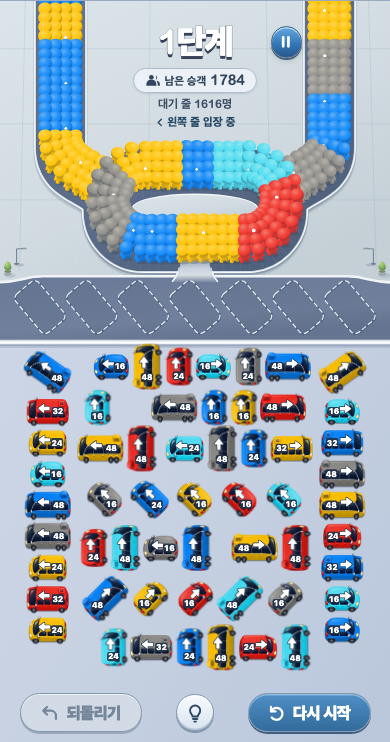

# Bus Puzzle

[브라우저에서 바로 플레이하기](https://chohyojae.github.io/bus-puzzle/)

주차된 버스를 어떤 순서로 승강장에 보낼지 고르는 브라우저 퍼즐입니다. 버스는 같은 색 승객으로 정원을 채워야 떠납니다. 승강장은 일곱 자리뿐이라, 48인승 버스에 32명만 타면 나머지 16명이 올 때까지 한 자리를 계속 차지합니다.

## 로컬 실행

프로젝트 루트에서 Bun 1.4.5로 실행합니다. 개발 도구와 테스트에는 Node.js도 사용하며, Node.js 26.13.1에서 확인했습니다.

```sh
bun ci
bun run dev
```

서버를 띄운 뒤 [해안 정류장](http://127.0.0.1:5173/bus-puzzle/)을 엽니다. 포트가 사용 중이면 터미널에 표시된 주소를 따릅니다. 이전 격자 퍼즐은 [클래식 모드](http://127.0.0.1:5173/bus-puzzle/?classic=1)에서 실행할 수 있습니다.

## 게임 방법

1. **지붕의 화살표와 숫자를 확인합니다.** 화살표는 출차 방향, 숫자는 정원입니다. 버스를 누르면 앞길이 비었을 때 승강장으로 이동합니다. 대각선 차량은 비스듬한 경로 전체가 비어야 합니다.
2. **순환 중인 승객과 대기 줄을 함께 봅니다.** 1단계는 승객 168명이 순환하고 1,616명이 줄에서 기다리는 상태로 시작합니다. 같은 색 승객이 탑승구를 지나면 버스에 탑니다. 순환로에 생긴 빈자리는 왼쪽 대기 줄의 승객이 먼저 채웁니다. 왼쪽 줄의 마지막 승객이 들어오면 오른쪽 줄이 움직입니다. 승객이 도는 속도는 탑승 중에도 일정합니다.
3. **빈 승강장을 남겨 둡니다.** 차종은 16·24·32·48인승입니다. 일곱 자리가 모두 차도 승객이 계속 탈 수 있으면 게임은 진행됩니다. 더 태우거나 출차할 수 없을 때는 **되돌리기**로 마지막 선택을 바꿀 수 있습니다.
4. **모든 버스를 만석으로 출발시키면 단계를 클리어합니다.** 1·2단계를 클리어하면 다음 정류장이 열립니다. 다음 차를 고르기 어려우면 화면 아래 전구 모양의 **힌트**를 누릅니다.

현재 새 판에는 단계마다 차량 57대가 있고, 그중 12대가 대각선으로 주차됩니다. 키보드에서는 `Tab`으로 차량을 선택하고 `Enter` 또는 스페이스로 출차합니다. `Esc`로 일시정지할 수 있습니다.

| 단계 | 정류장        | 차량·승객 색                              |
| ---- | ------------- | ----------------------------------------- |
| 1    | 등대 선착장   | 5색 · 파랑, 노랑, 빨강, 밝은 하늘색, 회색 |
| 2    | 파도길 정류장 | 8색 · 초록, 주황, 보라 추가               |
| 3    | 노을 부두     | 10색 · 남색, 흰색 추가                    |

3단계에서는 앞이 막힌 차가 검은색과 물음표로 표시됩니다. 길이 열리면 원래 색이 드러납니다. 회색은 첫 단계부터 회색 승객을 태우는 차량 색입니다.



## 저장과 설정

진행 상황은 현재 브라우저에 자동 저장됩니다. 이미 출차한 이전 버전의 판은 당시 배치로 이어지고, 다시 시작하거나 다음 단계로 넘어가면 새 배치가 적용됩니다.

**일시정지 → 설정**에서 효과음, 진동, 프레임 레이트(60·90·120FPS)를 변경할 수 있습니다. 기본값은 60FPS입니다. 기기를 바꿀 때는 **백업 및 데이터 이동**에서 `.bpz` 파일을 내보내고 새 기기에서 가져옵니다. 백업은 Zstandard로 압축되며 기존 JSON 백업도 읽습니다. 배포 빌드는 처음 온라인으로 열어 오프라인 준비가 끝나면 같은 주소에서 다시 플레이할 수 있습니다.

## 라이선스

© 2026 chohyojae. 이 프로젝트에서 직접 작성한 게임 코드, 테스트와 빌드 스크립트에는 **GNU Affero General Public License 버전 3만** 적용됩니다(`AGPL-3.0-only`). 배포된 게임의 **설정 → 앱 정보 → 게임 소스 코드**에서 해당 빌드의 소스를 확인할 수 있습니다. [라이선스 전문](LICENSE.txt)

외부 라이브러리와 WebAssembly 압축 모듈은 각 저작권자의 라이선스를 따릅니다. 게임 이미지·아이콘·문서는 위 코드 라이선스의 적용 범위에서 제외합니다. [라이브러리 고지](public/third-party-notices.txt) · [압축 모듈 고지](public/third-party-notices-wasm.txt)

## 개발 문서

| 문서                                            | 다루는 내용                                                                             |
| ----------------------------------------------- | --------------------------------------------------------------------------------------- |
| [앱 구조와 화면 렌더링](docs/architecture.md)   | 기본·이전·클래식 판의 진입점, 출차 입력 흐름, React와 SVG의 역할, 차량 그림과 클릭 영역 |
| [정류장 엔진과 퍼즐 설계](docs/depot-engine.md) | 단계 구성, 대각선 충돌 판정, 대기 줄 합류, 좌석 예약, 시간 처리, 클리어 검증            |
| [저장과 백업](docs/storage-and-backup.md)       | 체크포인트 재생, IndexedDB 저장 충돌, 버전 호환, BPZ 파일 구조, 백업 병합과 복구        |
| [개발·테스트·배포](docs/development.md)         | Bun 명령, Biome, 브라우저 테스트, 클래식 콘텐츠 도구, 오프라인 확인, GitHub Pages 배포  |
