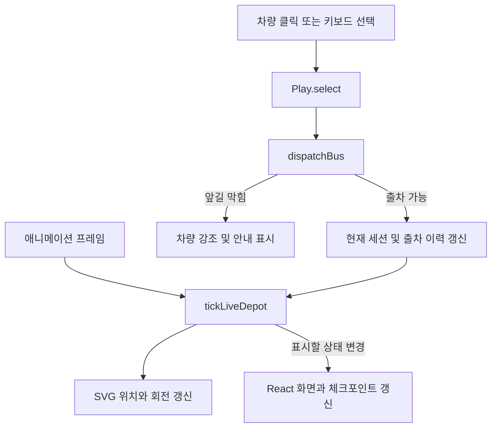

# 앱 구조와 화면 렌더링

## 실행 경로

브라우저가 `index.html`을 열면 `src/main.tsx`가 쿼리 문자열에 따라 React 진입점을 지연 로딩한다. 기본 게임은 정류장을 바로 열고, `?classic=1`에서는 클래식 홈을 연다. 두 게임은 설정 화면과 저장소를 공유한다. [앱 진입점](../src/main.tsx) · [설정 화면](../src/app/screens/SettingsScreen.tsx)

| 화면                           | 여는 방법                                                      | 규칙과 표시 방식                                    | 진행 기록                                  |
| ------------------------------ | -------------------------------------------------------------- | --------------------------------------------------- | ------------------------------------------ |
| 해안 정류장 (`compact`)        | 기본 주소                                                      | 연속 좌표의 주차장, 실시간 순환·탑승, React와 SVG   | `depotRun`                                 |
| 이전 정류장 배치 (`promenade`) | 호환되는 기록이 있을 때 일시정지 메뉴의 **이전 배치 이어하기** | 같은 정류장 엔진과 SVG 보드, 별도 경로와 승강장 3개 | `promenadeRun` 또는 이전 형식의 `depotRun` |
| 클래식                         | `?classic=1` → 시작하기 → 라운드 선택                          | JSON 라운드, 격자 기반 이동, PixiJS 캔버스          | `activeRun`                                |

정류장에서는 `useSave`가 초기 로드를 마친 뒤 `Play`를 마운트한다. `openDepot`가 선택한 배치의 세션을 만들거나 복원한다. 설정에서 백업을 가져온 후 **게임으로**를 누를 때도 최신 저장값으로 세션을 다시 연다. [정류장 화면](../src/game/depot/DepotGame.tsx) · [세션 복원](../src/game/depot/session.ts)

## 출차 한 번이 화면에 반영되는 과정

`dispatchBus`는 새 상태 또는 출차가 거절된 이유를 반환한다. 출차에 성공하면 `Play`가 차량 ID와 게임 시각을 이력에 추가하고, 출차 직전 상태를 되돌리기용으로 보관한다. 앞길이 막혔을 때는 선택한 차와 길을 막은 차를 표시한다. 운행 중 탭을 닫았다가 돌아오면 체크포인트에 기록한 시각까지 출차 이력을 재생한다. [화면의 입력 처리](../src/game/depot/DepotGame.tsx) · [엔진 판정](depot-engine.md) · [체크포인트와 백업](storage-and-backup.md)

## 프레임마다 바뀌는 값

`session.current.game`에는 현재 시뮬레이션 상태가 들어 있다. `startFrameLoop`는 `requestAnimationFrame`에서 전달받은 시각으로 선택한 프레임 간격이 지났는지 확인한다. 60·90·120FPS는 목표값이며 실제 호출 빈도는 화면 주사율에도 영향을 받는다. 정류장은 한 번의 콜백에 반영할 시간을 최대 0.2초로 제한한다. 문서가 숨겨지거나 설정·일시정지 패널이 열리면 프레임 루프를 중단한다. [프레임 스케줄러](../src/game/render/frame-loop.ts) · [주사율별 테스트](../tests/frame-rate.test.ts)

프레임이 오면 `tickLiveDepot`가 다음 상태를 계산하고 `DepotBoard.paint`가 차량과 승객의 SVG `transform`을 갱신한다. React가 다시 그려야 할 때는 `visibleState`로 판단한다. 승패, 탑승한 인원, 차량의 운행·블라인드 상태, 화면에 그릴 승객 ID가 여기에 들어간다. 예를 들어 한 승객이 같은 순환로를 따라 움직일 때는 좌표만 바뀌고, 대기 줄에서 순환로로 합류할 때는 React가 두 그룹의 구성을 갱신한다. 렌더 직후에는 `useLayoutEffect`에서 ID별 SVG 노드 참조를 갱신하고 최신 위치를 반영한다. [정류장 화면](../src/game/depot/DepotGame.tsx) · [SVG 보드](../src/game/depot/DepotBoard.tsx)

## 좌표와 차량 그림

| 항목      | 구현에서 사용하는 기준                                                                                                                                                                                         |
| --------- | -------------------------------------------------------------------------------------------------------------------------------------------------------------------------------------------------------------- |
| 게임판    | SVG의 `viewBox`는 `0 0 400 760`이다. CSS가 사용 가능한 폭·높이와 안전 영역에 맞춰 판을 배치한다. 차량 좌표와 크기는 SVG 단위다.                                                                                |
| 차량 방향 | 엔진은 위쪽을 0°, 오른쪽을 90°로 쓴다. 그림 원본의 앞은 오른쪽이므로 차량 그룹을 `pose.angle - 90`도 회전시킨다. 차체와 화살표, 투명한 클릭 영역이 함께 회전한다. 지붕의 정원 숫자는 역회전해 수평을 유지한다. |
| 차량 색   | 엔진의 색 키에 표시명과 표식을 대응한다. 현재 차량 그림은 `art/fleet/<색>-<정원>.webp`에서 읽는다. 블라인드 차량은 길이 열릴 때까지 `blind` 그림과 물음표를 쓴다.                                              |
| 승객      | 색별 SVG 모양을 `defs`에 한 번 정의하고 각 승객이 `use`로 참조한다. 대기 줄과 순환로에서 같은 승객 ID를 사용해 합류 전후를 추적한다.                                                                           |

차종을 추가할 때는 논리 정원·길이·폭과 그림 파일 이름을 함께 확인한다. 각도를 바꿀 때는 차체가 돌아간 상태에서 클릭 위치, 지붕 화살표, 실제 출차 방향이 일치하는지 확인한다. [차량과 승객 그림](../src/game/depot/DepotPieces.tsx) · [색상 정의](../src/game/depot/stages.ts) · [차량 그림 파일](../src/game/depot/art/fleet/) · [레이아웃 CSS](../src/game/depot/depot.css) · [대각선 출차 브라우저 테스트](../tests/e2e/depot.spec.ts)

### 입력과 피드백

현재 기본 배치에서 주차된 차량의 SVG 그룹에는 `role="button"`과 색·정원이 들어간 접근성 이름이 있다. 블라인드 차량은 접근성 이름에도 실제 색 대신 ‘블라인드’를 사용한다. 키보드의 `Enter`와 스페이스는 클릭과 같은 `onSelect`를 호출한다. 일시정지·도움말은 네이티브 `dialog`를 사용하며 닫을 때 이전 포커스를 복원한다. 효과음은 Web Audio로 재생하고, 진동은 설정이 켜져 있고 브라우저가 `navigator.vibrate`를 제공할 때 사용한다. [차량 입력](../src/game/depot/DepotBoard.tsx) · [대화상자](../src/app/Modal.tsx) · [효과음과 진동](../src/game/render/feedback.ts)

## 클래식 라운드를 수정할 때

클래식은 `src/content/rounds/`에서 `round.json`을 수집한다. 카탈로그를 읽으며 폴더 이름과 라운드 ID, 참조한 에셋을 확인한다. 차량 선택 시 `applyMove`가 다음 논리 상태와 이벤트 목록을 반환한다. 화면이 상태를 저장하고 `GameScene.enqueue`가 출차·탑승·출발 이벤트를 순서대로 그린다. 캔버스 위에 위치한 실제 HTML 버튼이 터치와 키보드 입력을 받는다. 클래식의 격자나 JSON을 변경할 때 사용하는 명령은 개발 문서에 정리했다. [라운드 카탈로그](../src/content/rounds/catalog.ts) · [클래식 화면](../src/app/screens/GameScreen.tsx) · [규칙](../src/game/domain/engine.ts) · [PixiJS 렌더러](../src/game/render/scene.ts) · [개발 도구](development.md)

[프로젝트 README](../README.md)
